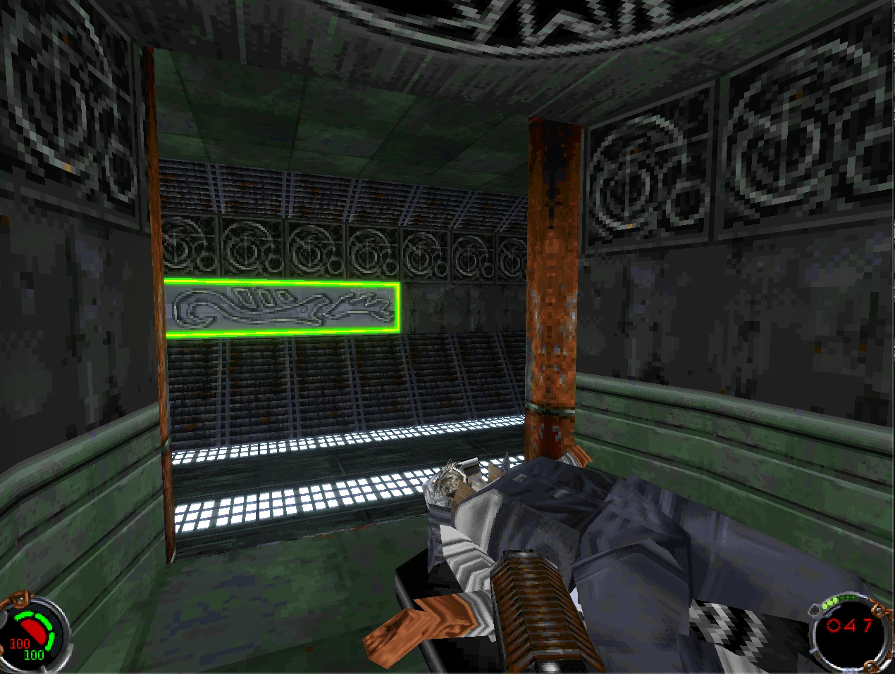

# Jedi Knight Remaster for Apple Silicon

A personal, non-commercial project to make **Star Wars Jedi Knight: Dark Forces II** (1997) run natively on Apple Silicon Macs and look properly modern, while still feeling like Jedi Knight. It's a facelift, not a different game.

Built on [OpenJKDF2](https://github.com/shinyquagsire23/OpenJKDF2), the community's function-by-function reimplementation of the original engine. This fork adds the remaster work on top and tracks upstream.

**No game assets are included or will ever be committed.** You need your own copy of the game (the GOG version is recommended).

## Goals

- Native arm64 macOS build at full Retina resolution, one command to build and run
- Modern lighting: per-pixel lights with specular highlights, tuned bloom and ambient occlusion, filmic tone mapping and colour grading via LUTs
- HD textures with proper material maps (normal, roughness, emissive), loaded alongside the originals without modifying the game files
- New high-detail models for Kyle, stormtroopers and the lightsaber, with a Blender pipeline for the .3DO and .KEY formats
- Upscaled, graded cutscenes played from modern video files
- Then the same treatment for the expansion, Mysteries of the Sith

## Milestones

| Stage | What | Status |
|---|---|---|
| 1 | Native build on Apple Silicon, one-command build and run | Done (2026-11-11) |
| 2 | Rendering: Retina, frame rate, filtering, tone mapping and LUT grading, per-pixel lighting | In progress |
| 3 | HD textures: extraction tool, true-colour replacement loader, material maps | Not started |
| 4 | Models: Blender import/export for .3DO and .KEY, new Kyle and stormtroopers | Not started |
| 5 | Cutscenes: modern video playback with the originals as fallback | Not started |
| 6 | Mysteries of the Sith: same pipeline for the expansion | Not started |

### Stage 2 checklist

- [x] Audit what the renderer already offers (bloom, SSAO, SSAA, filtering, FOV, frame cap are all built in)
- [ ] Scripted screenshots and frame timing for before/after comparisons
- [ ] HiDPI on by default on macOS
- [ ] Mipmaps and anisotropic filtering for true-colour textures
- [ ] Filmic tone mapping and colour-grade LUT (.cube) support
- [ ] Measure the cost of bloom, SSAO and SSAA
- [ ] Per-pixel lighting with normal and specular map support (plan first)

## Where it started



## Building (macOS, Apple Silicon)

```sh
git clone --recursive https://github.com/domdino/OpenJKDF2.git
cd OpenJKDF2
brew install cmake imagemagick openal-soft glew libpng openssl@3 protobuf libmodplug innoextract
scripts/build.sh
```

Extract your copy of the game into `gamedata/jk1/` (for the GOG installer: `innoextract --language english -I app <installer.exe>` and move the contents of `app/` there), then:

```sh
scripts/run.sh
```

Decisions, findings and dead ends are logged in [docs/DECISIONS.md](../docs/DECISIONS.md).

## Credits and legal

All engine credit goes to the OpenJKDF2 project and its contributors. Star Wars, Jedi Knight and related marks are the property of Lucasfilm and Disney. This project is not affiliated with or endorsed by them, includes no original game assets, and is for personal use only.
