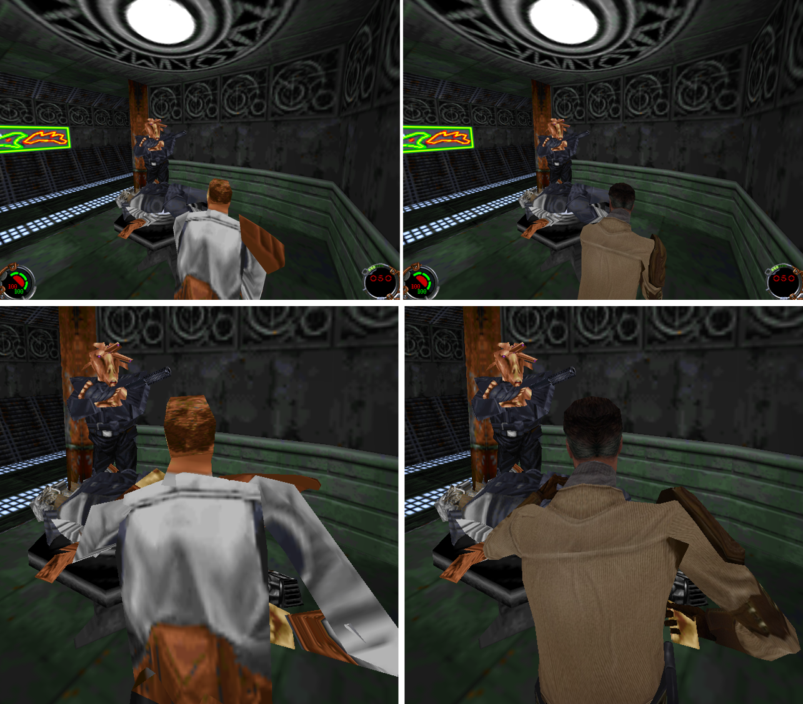
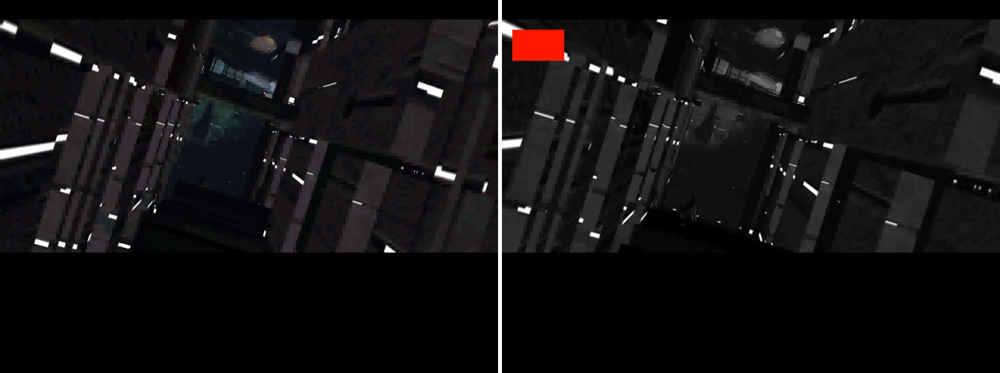

# Jedi Knight: Dark Forces II, remastered for Apple Silicon

**A personal project to rebuild the look of Star Wars Jedi Knight (1997) on a modern Mac, while keeping it unmistakably Jedi Knight.**


*Left: the game today, running natively on Apple Silicon. Right: the art direction (AI concept art of the same room, used as a north star, not a promise).*

---

## What this is

Jedi Knight is one of my all-time favourite games, and this fork is where I'm remastering it: native on Apple Silicon first, then modern lighting, HD materials, new models and upscaled cutscenes. The goal is the game as you remember it, rather than how it actually looked in 1997.

The engine is [OpenJKDF2](https://github.com/shinyquagsire23/OpenJKDF2), the community's function-by-function reimplementation of the original engine. All the hard reverse-engineering credit goes to that project. Everything here is built on top of it and kept in sync with it.

**What it isn't:** a new game, a mod pack or a commercial product. **No game assets are included or ever will be.** You need your own copy of the game (the GOG version is recommended).

## Art direction

The target is dark, wet, grimy and atmospheric: lived-in industrial rather than clean sci-fi. Light pools on wet metal, haze in the air, light shafts through skylights, dense blacks and a desaturated, warm-brown grade.

That breaks down into concrete engine work:

| The look needs | How | Status |
|---|---|---|
| Lights that pool on surfaces and glint off wet metal | Per-pixel lighting with specular highlights | Done (playtesting) |
| Wet floors reflecting light strips, sky and objects | Screen-space reflections | Done (playtesting) |
| Haze and light shafts | Depth-based haze lit by the scene, screen-space light shafts | Done (playtesting) |
| Filmic colour | Colour grading pass with live-reloading .cube LUTs from Resolve | Done |
| Glowing lights and sabers that roll off softly | Bloom (built in) into a half-float buffer with highlight roll-off | Done |
| Every shot lit like a film: side key light, rim light on every character, nothing flat | Light bake with recovered designer lights; key/rim lighting rig for characters | Characters: first pass done; levels: light maps in game on six levels, tuning next |
| Crisp, detailed, grimy surfaces | HD textures with roughness and normal maps | Stage 3 |
| Detailed characters | New models through a Blender pipeline | Stage 4 |

## Progress

| Stage | What | Status |
|---|---|---|
| 1 | Native build on Apple Silicon, one-command build and run | Done |
| 2 | Rendering: Retina, filtering, colour grading, per-pixel lighting, atmosphere | In progress |
| 3 | HD textures with material maps, true-colour replacement loader | In progress |
| 4 | Models: Blender import/export for .3DO and .KEY, new Kyle and stormtroopers | In progress |
| 5 | Cutscenes: upscaled and graded, played from modern video files | In progress |
| 6 | Mysteries of the Sith: the same treatment for the expansion | Not started |

### Stage 2 checklist

- [x] Audit what the renderer already offers (bloom, SSAO, SSAA, filtering, FOV and frame cap are all built in)
- [x] Silent, repeatable screenshot and frame-timing captures for before/after comparisons
- [x] Retina (HiDPI) by default on macOS
- [x] Mipmaps and anisotropic filtering for true-colour textures
- [x] Colour grading: exposure, highlight roll-off, live-reloading .cube LUTs
- [x] Measure the cost of bloom, SSAO and SSAA (130+ fps with everything on)
- [x] Art direction chosen
- [x] Per-pixel lighting with wet highlights for dynamic lights ([plan](../docs/stage2-lighting-plan.md)), being playtested
- [x] Highlights from glowing surfaces: built, but reads as blobs rather than wet; off by default
- [x] Screen-space reflections for wet, reflective floors (being playtested)
- [x] Coloured light from sabers, including enemy sabers
- [x] Haze and light shafts (being playtested)
- [x] Volumetric cloud sky with moon shafts on the storm levels (Maw, Sarris, the ascent); other skies to follow
- [x] Cinematic key and rim light on characters and props (first pass)
- [x] Light bake in game: baked light maps replace the 1997 corner light on six test levels (`r_lightmaps`, in the remaster preset) ([plan](../docs/stage2-lightbake-plan.md))
- [ ] Light bake: tune and bake every level (sun for day levels, light probes for characters)
- [x] One-switch preset: `remaster 1` in the console

### Stage 3 checklist

- [x] Research: OpenJKDF2 already loads HD texture packs (colour, glow, displacement maps)
- [x] Tool to extract every original texture to PNG (`tools/mat_extract.py`)
- [x] Rebuild the community Neural Upscale pack from its installer (555 textures matched so far)
- [x] Rebuild from all three Remastered installers, palette-correct (no wrong colours in other levels)
- [x] Engine fix: HD texture hashes use the level's real palette (coverage went from almost none to dozens per view)
- [x] Performance: full remaster + HD runs at 156 fps on the MacBook's native screen; a 7680x3240 ultrawide gets automatic render scaling (52 -> 77 fps). The earlier slowdowns were Topaz and Texture God sharing the GPU
- [x] Material maps in the engine: roughness, metalness, AO and normal maps per texture (rock defaults to matte)
- [x] Importer for Texture God output (my own AI upscaling and PBR pipeline)
- [x] First full Texture God batch in game (217 level textures, gritty look, own pack)
- [ ] Roughness and normal maps for the wet, grimy look (loader support plus generation)
- [ ] Upscale and hand-finish key textures (hangar, Nar Shaddaa, Kyle)

### Stage 4 checklist

- [x] Blender tools: the community [blender-sith](https://github.com/smlu/blender-sith) add-on, tested on Kyle and the stormtrooper (model and animation in and out of Blender 5.3, identical in game)
- [x] Tool to pull any model, animation or texture out of the game archives (`tools/gob_extract.py`)
- [x] Engine limits mapped: 512 vertices and 512 faces per body part, 64 joints
- [x] Raise the per-part limits for detailed models (8192 vertices per mesh)
- [x] Skinning: one continuous mesh bends with the original skeleton, so every original animation drives modern characters (tested pixel-identical)
- [x] Fit Jedi Academy's Kyle onto JK's skeleton (tools/blender/ja_to_jk.py): in game, driven by the original animations
- [x] Stormtrooper from Jedi Academy (keeps JK's own rifle as a rigid part)
- [x] The cast from Jedi Academy: officers, commandos, Grans, Rodians, Trandoshans, Ugnaughts (18 JK models)
- [x] Animation check: crouch, fire, jump, punch and saber swing drive the new Kyle cleanly
- [ ] Named characters (Jerec and the Dark Jedi, Jan) and civilians
- [ ] Material pass on the converted characters (Texture God) - Kyle done (roughness/AO/normal maps)
- [ ] New Kyle, built in the original's 16 rigid parts so every existing animation still drives him
- [ ] New stormtrooper
- [x] New lightsaber: Kyle's hilt from Jedi Outcast in third person, first person and the pickups
- [x] Third-person weapons no longer carry the 1997 hand
- [x] Glowing plasma blades: white-hot core, coloured sheath and halo, animated, lighting the room (`r_saberGlow`)
- [x] Lightsaber swing trails (only on real swings)
- [x] First-person hands: Kyle's gloves and sleeves on every weapon view
- [x] First-person hands v2: bare hands (free PSX arms pack), rounded sleeves, Texture God jacket

### Stage 5 checklist

- [x] Extract all 25 cutscenes (640x300, 15 fps, 33 minutes) to ProRes for upscaling and grading (`scripts/extract_cutscenes.sh`)
- [x] Engine plays HD replacements (H.264, HEVC or ProRes, any resolution or frame rate) in place of the originals, with the originals as fallback and subtitles kept
- [x] Upscale all 25 (Topaz, 3x to 1920x900, original 15 fps; interpolation looked janky)
- [ ] Grade in After Effects
- [ ] Playtest every cutscene in game

## Latest

All 25 cutscenes now play upscaled in game (Topaz, 1920x900), and first-person view shows Kyle's own gloves and sleeves:


The lightsaber blade is now a glowing plasma beam instead of a flat textured strip: a white-hot core, a deep coloured sheath and a soft halo that lights the room, with plasma that ripples and hums. Enemy sabers keep their own colours. ([video](../docs/screenshots/stage4-saber-blade.mp4))


Stage 4: most of Jedi Knight's cast now uses Jedi Academy's characters, fitted onto the original skeletons so every 1997 animation still drives them. Same lighting and framing for each pair:


In game, Nar Shaddaa (left 1997, right remaster):


Stage 4: the engine now supports skinned characters, and Jedi Academy's Kyle runs in Jedi Knight on the original skeleton and animations (left original, right Academy Kyle; bottom: mid-run, same animation).



Stage 5 has started. Every cutscene is extracted for upscaling, and the engine now plays HD replacement videos (H.264, HEVC or ProRes, any resolution or frame rate) in place of the 640x300 originals, decoded on the Mac's media engine. The original keeps running underneath for timing, sound and subtitles. Left: original. Right: a black-and-white 1080p test file proving the swap.



Stage 3 has started. Top: the remastered look on the original textures. Bottom: the same with HD textures from the community Neural Upscale pack (the Sarris building and Boc's rock wall gain real detail). The game's own loader already reads HD texture packs; new tools extract every original texture for upscaling and rebuild packs whose files lost their names.


The whole Stage 2 look behind one switch: open the console (backtick) and type `remaster 1` (`remaster 0` for the original). Top: original game. Bottom: remaster preset (per-pixel light with wet highlights, coloured saber light, reflections, haze, light shafts, grade, bloom, ambient occlusion).


Haze and light shafts, first pass (left off, right on): the hangar gets a hazy glow around the shuttle and light spilling from the wall strips; the rooftop's sky and far building sit back in hazy air.


Screen-space reflections, first pass: wet floors now mirror what's around them (top off, bottom on). Hangar floor reflecting the shuttle and light strips, the wet rooftop reflecting the figures, and Boc's saber throwing a pink pool.


Per-pixel lighting, phase 1. The same light near the far wall: the original per-vertex lighting (left) barely shows it; per-pixel (right) gives a proper pool of light and a wet glint on the ceiling ring.


Built-in effects, all running natively. Top: original, bloom. Bottom: ambient occlusion, everything on with a test grade.


Decisions, findings and dead ends are logged as I go in [docs/DECISIONS.md](../docs/DECISIONS.md).

## Building it yourself (macOS, Apple Silicon)

```sh
git clone --recursive https://github.com/domdino/OpenJKDF2.git
cd OpenJKDF2
brew install cmake imagemagick openal-soft glew libpng openssl@3 protobuf libmodplug innoextract
scripts/build.sh
```

Extract your own copy of the game into `gamedata/jk1/`. For the GOG installer: `innoextract --language english -I app <installer.exe>`, then move the contents of `app/` there. Then:

```sh
scripts/run.sh
```

To see the remastered look, open the console in game (backtick) and type `remaster 1`. Colour grades live in `grade/`; the game reloads `grade/default.cube` live whenever it changes.

## Credits and legal

All engine credit goes to the [OpenJKDF2](https://github.com/shinyquagsire23/OpenJKDF2) project and its contributors. Star Wars, Jedi Knight and related marks are the property of Lucasfilm and Disney. This project is not affiliated with or endorsed by them, includes no original game assets, and is for personal, non-commercial use only. Concept images are AI-generated references for art direction.
